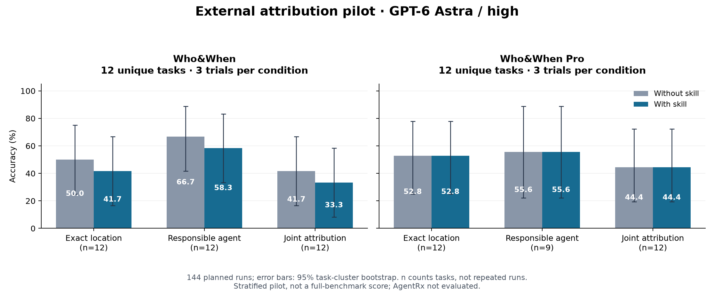
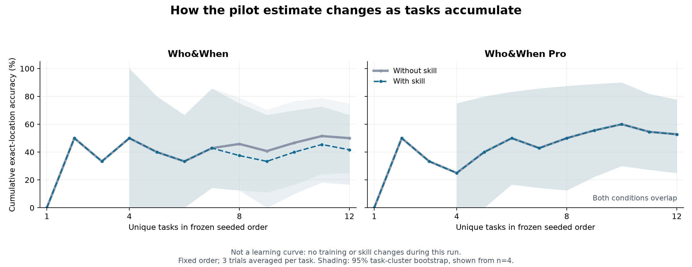
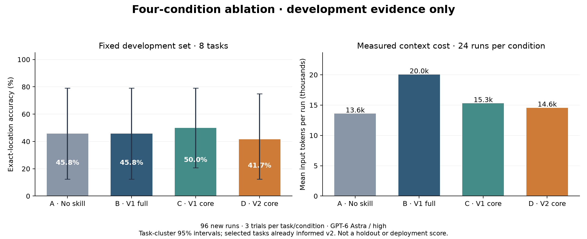
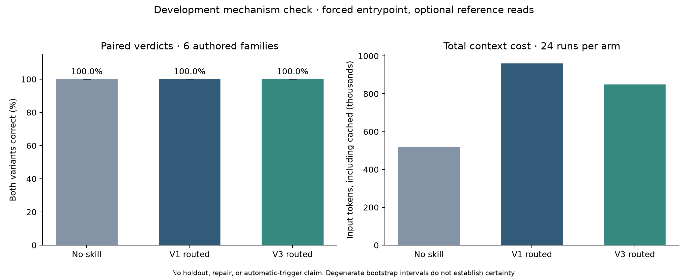
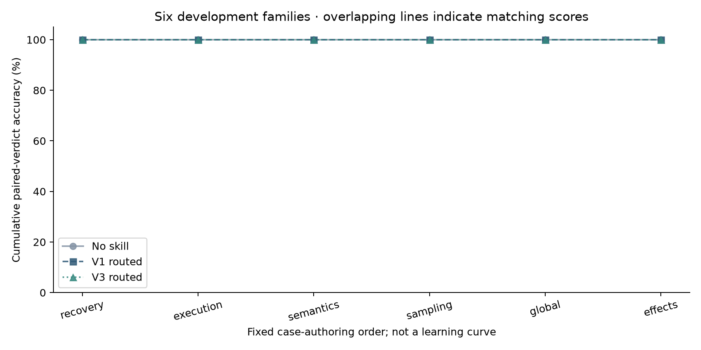

# Agent Composition Review

一个以组合思想为指导的 Agent 架构诊断 Skill。沿数据流检查类型、语义契约、状态与不变量，把异常转化为有证据的根因判断、最小修复和可执行验证。

**当前状态：`0.1.0-dev`，可运行的发布草案。** 项目独立维护于 [meiluosi/agent-composition-review](https://github.com/meiluosi/agent-composition-review)，当前为私有仓库。已有公开问题复现和独立模型试用；已完成首轮外部数据对照，实际结果与限制见下方评测区。自动检查状态见 [GitHub Actions](https://github.com/meiluosi/agent-composition-review/actions)。项目许可证尚未选择，不宣称已经完成开源发布。

## 它适合什么

- Agent 各节点单独工作正常，组合起来却失败。
- 数据结构合法，但单位、知识状态、错误含义或字段所有权不一致。
- 缓存改变了采样语义，重试或恢复造成重复副作用。
- 多智能体输出能解析，却无法按整体约束合并。
- 重构后局部差异很小，但端到端动作发生变化。

对于普通文案润色或孤立算法问题，无需加载它。进入诊断后若证据指向节点内部，也应直接处理，不强行归因为“组合问题”。

## 使用

将仓库中的 `SKILL.md`、`agents/`、`references/` 放在同一个名为 `agent-composition-review` 的技能目录中。Codex 的个人技能目录可使用 `~/.codex/skills/agent-composition-review/`。无需将评测答案或框架依赖安装到技能目录。

可以生成只含这五个运行时文件的迁移包：

```sh
python3 scripts/build_skill.py
```

解压 `dist/agent-composition-review.zip` 后，把其中的技能目录放入目标运行环境的技能目录。覆盖已有安装前先保留自己的修改。

调用示例：

```text
使用 $agent-composition-review 排查当前 Agent 的异常。
先还原失败链路，根据实际输入输出检查类型、状态与契约；
区分已证实和待验证的原因，给出最小修复并运行相关验证。
```

也可以请求架构审查或新旧路径的重构验证。具体执行规则见 [SKILL.md](SKILL.md)。

## 模块化框架开发

项目继续使用一个主 Skill、一个 Git 仓库。新理论按诊断需要放入参考模块；只有出现独立任务、独立验收和独立发布需求，才考虑拆成其他 Skill。

[系统性框架设计](docs/categorical-framework.md) 将接口与组合、运行语义、契约与精化、证据抽象、随机与因果、局部与整体、定量验证连接起来。[v3 候选](evals/iterations/v3-candidate/SKILL.md) 包含一个入口、六份按需参考及一个证据记录检查器。它尚未替换当前主版本或个人安装；数学依据、工程假设和模型效果分别说明。

检查器只能验证记录引用与状态一致性，不能证明事实真实或根因正确。候选评测协议见 [成对机制方案](evals/iterations/mechanisms-2026-09-29/ANALYSIS_PLAN.md)。单独打包候选：

```sh
python3 scripts/build_skill.py --source evals/iterations/v3-candidate
```

输出为 `dist/agent-composition-review-candidate.zip`，包含九个运行文件，不包含评测案例、标签和维护文档。默认打包命令仍生成当前主版本。

## 一个已复现的例子

[LangGraph #6446](https://github.com/langchain-ai/langgraph/issues/6446) 报告了父图与子图并行时的字段冲突。本地执行发现：叶节点只修改 s1/s2，但子图输出完整状态，旧 b 被父图当作更新，与另一节点的新 b 冲突。

修复明确子图的输出 schema，只提交它负责的字段，同时保留完整读取上下文和原有并行关系。之前的独立执行中，有/无 Skill 两组都完成了该修复，并各通过 8 项验收及原例处理函数回接检查。详细结论见 [历史评测摘要](evals/runs/history-v1.md)。

这体现了一个重要问题：组件返回的是完整快照、更新补丁，还是操作命令？结构相同不代表语义相同。

## 案例库

| 案例 | 来源类型 | 主要检查 | 当前证据 |
| --- | --- | --- | --- |
| LG-6446：子图透传旧状态 | 公开 issue 的本地复现 | 读字段和写字段的边界 | 原例复现、独立修复试用、运行回归 |
| LG-8754：读取创建空线程 | 公开 issue 的本地复现，版本不同 | 读取是否有隐藏副作用 | 本地复现及有限范围的修复对照 |
| DOC-INTERRUPT：恢复重复执行 | 官方文档行为的自建例子 | 重放范围和操作幂等性 | 真框架运行及本地效果计数 |
| 六个文本场景 | 自建场景，由模型编写 | 单位、采样、反例、全局约束、缺证据、节点错误 | 旧版两组独立回答与匿名评审 |

详见 [案例说明](docs/cases.md) 和 [机器可读清单](evals/cases.json)。上述案例已参与设计，属于开发集；外部实验的独立抽样另见下文。框架测试使用真实 LangGraph 执行器，不调用模型或外部业务服务。

## 验证

Python 3.12；在独立虚拟环境安装锁定依赖：

```sh
python3.12 -m venv .venv
.venv/bin/python -m pip install -r requirements-eval.txt
.venv/bin/python scripts/check_repo.py
.venv/bin/python scripts/run_evals.py
.venv/bin/python scripts/build_skill.py
```

这些命令验证格式、文件引用、案例登记、框架行为与打包。**它们不测模型读完 Skill 后是否更会排障。** 当前框架回归有 10 个测试方法，涵盖三个案例；完整记录见 [本轮执行结果](evals/runs/2026-09-29-framework.json)。

模型能力评测的对照条件、指标、阻止发布的条件和记录要求见 [评测协议](evals/PROTOCOL.md)。以后提出“效果更好”的结论，需要附有该协议下的对照证据，而不是仅展示绿色 CI。

外部数据已接入 Who&When 与 Who&When Pro text，并完成下方列出的首轮 144 次对照运行；AgentRx 等待访问授权。来源与覆盖限制见 [专业数据集与接入状态](docs/benchmarks.md)。数据集完整规模不等于本轮已评测样本数。

本轮新增参考指令另做了 [独立前向试用](evals/runs/2026-09-29-forward/report.md)：执行者识别出违规的查询写入，给出并验证修复，也没有把明确允许的缓存写入误报为故障。这是两个简化组件的一次开发集检查，无对照组；判据登记晚于任务分发，不能视为完整协议下的效果评测。范围与证据见 [记录](evals/runs/2026-09-29-forward/result.json)。

<!-- external-pilot:start -->
## 外部基准首轮实验

2026-09-29，**完成 144/144 次计划运行；有效完成 144 次**。请求模型为 **gpt-6-astra / high**，每个数据集 12 个任务、每组每例 3 次重复。实验前冻结输入、评分器、Skill 快照和分析方案；运行中未调优 Skill。

首要指标为错误位置严格匹配的准确率。先对同一任务的重复取平均，区间按任务聚类进行 10,000 次配对 bootstrap；不是把 144 次运行当作 144 个独立样本。

| 数据集 | 任务数 | 无 Skill | 有 Skill | 差值（百分点） | 差值的 95% 区间（百分点） |
| --- | ---: | ---: | ---: | ---: | --- |
| Who&When | 12 | 50.0% | 41.7% | -8.3 | [-22.2, +0.0] |
| Who&When Pro | 12 | 52.8% | 52.8% | +0.0 | [+0.0, +0.0] |

**本轮未观察到首要指标的提升。** Who&When 的差值区间包含 0；Who&When Pro 的差值区间包含 0。这是一项分层抽样的小样本试验，不是全量基准成绩，也不能据此证明生产系统、代码修复或整体架构质量的提升。 若差值区间为 [0, 0]，表示本次每个任务的两组平均得分恰好相同；小样本的经验 bootstrap 无法由此推断未来差异也为零。



图中 n 为指标适用的任务数；无 Agent 标签时联合指标只检查位置。[查看配对差值图](docs/assets/external-pilot-difference.png)。

下图按预先固定的任务顺序展示累计定位准确率。它反映样本增加时估计如何变化，**不是训练曲线**，没有按结果调整顺序。



范围：已下载 Who&When 184 条及 Pro text 6,257 条；这里只评测所列 24 个任务。Pro 的部分位置映射及 Who&When 的超长输入未进入抽样池，详见排除记录。AgentRx 尚受访问授权限制，未运行。所有外部样本都是失败轨迹，不能据此估计正常系统误报率。公开数据也可能已被模型预训练见过。

结果与复现：[完整实验说明](docs/external-evaluation.md) · [冻结清单](evals/external/pilot-manifest.json) · [逐次预测与评分](evals/external/results/pilot-2026-09-29/predictions.json) · [汇总](evals/external/results/pilot-2026-09-29/summary.json) · [资源统计](evals/external/results/pilot-2026-09-29/report.md)。图表可以从公开评分表重画，无需再次调用模型。
<!-- external-pilot:end -->

事后逐例分析见 [首轮复盘与迭代设计](docs/pilot-postmortem.md)：净退化集中在两个任务，涉及已恢复错误、未执行风险及最早责任位置的区分。已保存未启用的 v2 候选，并完成下方四组开发消融。主 Skill 尚未替换，首轮成绩保持原样。

<!-- development-ablation:start -->
## 四组开发集消融

首轮复盘后，针对 8 个已参与设计的任务重新运行四组、每例每组 3 次，共 **96 次新运行**。A 无 Skill；B 旧版全包；C 旧版正文；D 候选正文。A/B 提示词与首轮一致，本轮重新采样；正文组不能读取参考链接。这是开发机制检查，不能证明保留集提升或实际自动触发效果。

| 条件 | 定位命中 | 准确率 | 输入 token 合计 | 输出 token 合计 | 墙钟中位数 |
| --- | ---: | ---: | ---: | ---: | ---: |
| A · No skill | 11/24 | 45.8% | 326,014 | 6,943 | 34.2s |
| B · V1 full | 11/24 | 45.8% | 480,904 | 7,996 | 35.2s |
| C · V1 core | 12/24 | 50.0% | 367,076 | 7,057 | 34.3s |
| D · V2 core | 10/24 | 41.7% | 349,428 | 7,191 | 35.3s |



每个条件有 24 次运行，但只有 8 个任务。按任务聚类的区间和逐例变化见 [实验报告](evals/iterations/ablation-2026-09-29/REPORT.md)。历史 144 次未并入此表；费用未知，token 与墙钟记录不等于货币报价或纯服务延迟。

[逐任务成功次数图](docs/assets/development-ablation-cases.png) · [冻结清单](evals/iterations/ablation-2026-09-29/manifest.json) · [逐次预测](evals/iterations/ablation-2026-09-29/predictions.json) · [复现方法](docs/ablation-evaluation.md)
<!-- development-ablation:end -->

**本轮决定：v2 候选未获升级依据，继续保留主版本。** 旧版正文较全包少用 23.7% 输入 token，但准确率仅多命中一次；旧版全包在这次复测中与无 Skill 持平。详见 [逐例复盘与下一步实验方向](docs/ablation-findings.md)。

## 模块化 v3：72 次成对机制检查

完成 **72/72 次有效运行**：六个自建开发家族、每家族两个相邻变体，比较无 Skill、v1、v3，每例各两次。主入口强制注入，参考文件由模型实际按需读取；三组具有相同的只读工具和共同输出协议。这不是自动触发测试，也不是新的外部基准成绩。

| 条件 | 成对契约判断 | 离散命题严格匹配 | 正常例误报 | 输入 token |
| --- | ---: | ---: | ---: | ---: |
| 无 Skill | 100% | 71/72 | 0/10 | 519,767 |
| v1 按需参考 | 100% | 70/72 | 0/10 | 960,368 |
| v3 按需参考 | 100% | 72/72 | 0/10 | 848,565 |



**主指标未观察到提升，v3 继续保留为候选。** 这套短案例出现天花板，且次要位置与命题题面存在目标歧义；不能将候选的命题匹配结果直接解释为稳定收益。v3 输入比 v1 少 11.6%，仍比无 Skill 多 63.3%。本轮与前两轮的任务、工具和指标不同，不能接成一条效果提升曲线。



三条线重叠反映相同成绩；这不是训练曲线。只有六个开发家族，经验区间退化不代表未来确定性。实际读取参考的运行数为 v1 23/24、v3 22/24；程序检查器本轮未被模型调用，其作用不能由该表推出。

[实验报告](evals/iterations/mechanisms-2026-09-29/REPORT.md) · [逐次预测](evals/iterations/mechanisms-2026-09-29/predictions.json) · [机制复盘与版本决定](docs/mechanism-findings.md) · [复现与边界](docs/mechanism-evaluation.md)

## 仓库结构

```text
SKILL.md / agents/ / references/   模型使用的技能包
README.md / docs/                 人类使用和维护说明
evals/cases/                      可执行的框架复现与回归
evals/scenarios/                  模型试用输入与维护者判据
evals/runs/                       已完成评测的证据与限制
evals/external/                   外部数据适配、冻结清单与模型对照结果
scripts/                         校验、测试、打包
.github/                         CI、案例提交表与 PR 模板
```

未来补充的信息优先是：真实边界契约、可复现失效条件、能区分竞争假设的问题，以及明确的验证判据。理论背景按需放入 references，不把更多术语或更长文件作为进步指标。

## 贡献与持续迭代

欢迎提交脱敏故障、正常反例和复现差异。一次改动最好对应一个具体问题：添加失败案例与验收 → 修改最小规则 → 回归旧案例 → 用未参与修改的新案例检查迁移。步骤见 [CONTRIBUTING.md](CONTRIBUTING.md)。

灵感来自用户提供的《组合智能》摘要；数学参考在技能参考文件中。没有该书全文，不声称复刻原书的定义、公式或章节。写法参考过 [女娲.skill](https://github.com/alchaincyf/nuwa-skill)，本项目不是人物蒸馏或角色扮演 Skill。公开案例链接用于说明来源；本仓库中的新回归实现没有打包原 issue 页面、原仓库代码或本地虚拟环境。

当前仓库归属 meiluosi，使用独立 Git 历史。对外公开前由维护者选择许可证并确定发布范围；本项目没有默认授予开源许可。
