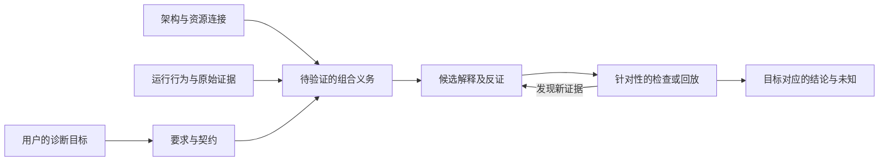

# 从组合检查清单到可验证的诊断流程

本页记录 v3 候选的理论设计，不代表主 Skill 已升级或模型能力已改善。候选入口在 [v3-candidate](../evals/iterations/v3-candidate/SKILL.md)。效果需要独立于数学表述进行评测。

## 一项任务，一个入口，按问题读取模块

目前保留一个 Skill、一个 Git 项目。共同任务是检查 Agent 系统的组合行为；理论模块是帮助判断的参考，不是七个必须依次执行的子 Agent。主入口负责确定目标、保留证据和选择模块；程序负责可机械检查的引用与记录约束；案例负责检验模型是否作出有依据的判断。

未来只有出现独立使用需求、稳定的输入输出、可单独验收的完整流程，才考虑拆出“重构验证”等独立 Skill。理论名称本身不是拆分依据；独立安装和发布需求才可能进一步支持分仓。

## 必须区分的三件事

1. **数学定义与结论**：在写明对象、态射、公理和前提的模型中成立。
2. **工程建模**：将实际组件、状态、要求和日志映射到模型；可能不完整，需要证据检查。
3. **模型使用效果**：LLM 读到指导后是否诊断得更好；由对照实验判断，不能由前两项推出。

范畴论不是现成的 Agent 类型系统。`string` 可以是合理的传输载体；真正要检查的是业务需要的区别是否被表达、保留和验证。节点内部、边界和环境都可能出错，当前没有数据支持将“大多数事故在边上”设为普遍归因先验。

专题模块用于帮助提出和验证组合义务。结论必须能沿原始证据回溯，不因增加一道摘要或多一个 Agent 而获得额外确定性。

## 七个逻辑模块

| 模块 | 建模内容与数学依据 | 前提和边界 | 可验证的工程义务 |
| --- | --- | --- | --- |
| 接口与组合 | 选择对象、态射、恒等和组合；必要时用幺半结构、接线图表达并置与开放系统 | 执行图本身还没有给出行为语义；不能同时混用不同模型中“节点/边”的含义 | 接口相容、依赖显式、共享资源完整；实际行为在组合后仍可解释 |
| 运行语义 | 状态转换、计算效应；适当时用 Monad/Kleisli 或开放动力系统 | 状态、异常、概率、外部效应的组合需要明确语义；写出一个签名不等于满足公理 | 重试、取消、反馈和并行的效果计数、状态及终止符合要求 |
| 契约与精化 | 明确假设、保证及行为允许集；关联架构、行为和要求 | 类型匹配不等于业务正确；替换所保留的观察范围及精化方向必须声明 | 上游保证支持下游假设；替换后满足调用方需要的保证 |
| 证据与抽象 | 具体事件、摘要、候选和结论间的信息关系；可借鉴抽象解释及信息序 | 尚未构造具体域/抽象域与 Galois 连接，LLM 摘要没有健全性证明 | 引用不断裂，未知不静默变事实，恢复和反证不在摘要时消失 |
| 随机性与因果 | Markov 范畴表达随机核、复制及条件独立；因果判断另需结构与干预 | 多次调用不必独立；观察依赖不等于因果，干预成功不证明唯一性 | 样本来源可追踪；修复回放有明确改变对象、环境及成功判据 |
| 局部与整体 | 局部范围、限制映射、重叠与胶合 | 只有满足相应层公理的模型才能援引胶合保证；普通任务分配不自动形成层 | 重叠契约一致、整体覆盖完整、共享资源和预算可行 |
| 定量组合 | 任务距离、资源组合规则、近似交换、适用时的富集结构 | 经验敏感度不是全局界；效率通常是预算或优化目标，不是自动保持的不变量 | 在约定容差内比较端到端结果、副作用及资源，并量化不确定性 |

七个逻辑模块对应六个运行参考文件：接口和契约共享 [contracts.md](../evals/iterations/v3-candidate/references/contracts.md)，其余按症状分开。目录结构服务于读取需要，不追求概念数和文件数相等。

## 三个关键推理约束

**组合有条件。** 在一个简化的顺序契约模型中，若 f 在 P 下保证 Q，g 需要 R，必须检查 Q 是否足以支持 R；还需考虑中间状态变化、异常和共享效应。组合规律不允许任意重排操作。

**信息保持有范围。** 函子保持恒等与组合，不自动保持任意业务不变量。若要说适配器、摘要器或重构是结构保持映射，必须明确源/目标模型、哪些关系被保持，以及相应等式或近似关系。当前候选主要执行工程契约检查，不将所有适配器命名为函子，也不将任意重构命名为自然变换。

**因果需要额外证据。** 一个本地异常、一个最终错误产物和“修复该异常将导致任务成功”是三种不同主张。恢复的局部错误仍是历史事实；它是否影响最终失败取决于后续行为和干预证据。对于没有回放条件的轨迹，保留候选和区分它们所需的验证，不补造反事实。

## 中间记录和检查器的实际能力

候选让复杂诊断保存需求、事件及发现，并将执行状态、结论状态、恢复状态和因果状态分开。格式及例子见 [evidence.md](../evals/iterations/v3-candidate/references/evidence.md)，检查器为 [check_evidence.py](../evals/iterations/v3-candidate/scripts/check_evidence.py)。

它能拒绝重复 ID、未知引用、缺失字段、confirmed 与 planned 冲突、没有证据引用却声称已恢复等记录。它不能识别一个语法合法但虚假的“观察”，也不能从引用存在推出引用支持了结论。测试显式包含这一能力边界，避免把程序检查包装成事实验证。

主入口不要求短问题先生成 JSON。对简单任务，直接回答并保留必要证据；对跨多步、多候选或多次交接的任务，结构化记录才更可能值得其成本。是否实际改善模型输出仍需评测。

## 迭代顺序及验收

1. 冻结候选与成对机制案例，保留上一版本和无 Skill 对照。
2. 分别检查程序规则、模型离散判断、引用以及资源；自由文本复盘不冒充盲评。
3. 若出现新错误，记录触发条件和竞争解释，不事后改标签或只补跑失败组。
4. 若候选在开发案例有保留价值，再用新任务验证领域错误、真实修复、长轨迹、反事实恢复及触发边界。每次新协议重新运行相应基线。
5. 只有获得对应能力的证据，才更新正式入口、安装包和效果说明。开发案例全过也不证明实际泛化收益。

理论背景在维护文档中完整表达，运行时只保留会改变判断的规则。新理论模块加入前必须写出适用条件、必要证据、推理规则、相邻反例和可执行验证；不能仅为增加术语而扩展入口。

## 一手来源及用途

- [Fong 与 Spivak：Seven Sketches in Compositionality](https://arxiv.org/abs/1803.05316)：组合建模、序与伴随、资源、度量和富集的基础。
- [Bakirtzis、Fleming、Vasilakopoulou：Categorical Semantics of Cyber-Physical Systems Theory](https://arxiv.org/abs/2010.08003)：架构、行为与契约视图的关联。其系统领域不同，不能直接移植为 Agent 正确性保证。
- [Moggi：Notions of computation and monads](https://doi.org/10.1016/0890-5401(91)90052-4)：带效应计算的语义。
- [Myers：Categorical Systems Theory](https://www.davidjaz.com/Papers/DynamicalBook.pdf)：开放系统、状态与交互的进一步建模。
- [Cousot：Abstract Interpretation in a Nutshell](https://www.di.ens.fr/~cousot/AI/IntroAbsInt.html)：抽象必须说明正确性条件。记录约束目前只是工程应用，并非完整的抽象解释实现。
- [Fritz：A synthetic approach to Markov kernels, conditional independence and theorems on sufficient statistics](https://arxiv.org/abs/1908.07021)：随机计算、独立性与确定性态射。
- [Yin 与 Zhang：Markov categories, causal theories, and the do-calculus](https://arxiv.org/abs/2204.04821)：因果结构与干预语义的额外条件。
- [Stacks Project：Sheaves，Definition 6.7.1](https://stacks.math.columbia.edu/tag/006S)：层的胶合条件。

用户提供的《组合智能》摘要是项目灵感来源；没有该书全文，不补造其章节、公式或重构模式。上面的运行流程、记录协议和 Agent 案例属于本项目的设计，不是上述文献报告过的 Agent 效果。
