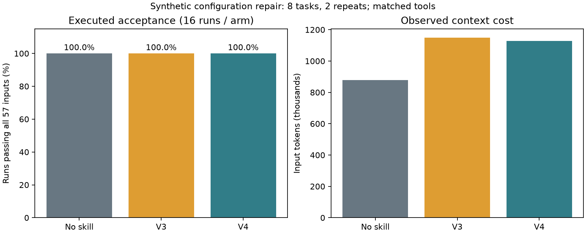

# 评测档案：旧版组合审查 Skill 的实验记录

> **这是一份历史证据档案，不是 v0.1 产品承诺。**
>
> 2026 年 9 月至 10 月，本项目以“组合审查 Skill 文本”为对象做过若干轮模型行为实验。v0.1 重新定位为面向公开开发者的 `acr` 命令行工具后，这些结果被原样保存在这里，供需要核查证据的人使用。它们不用于宣称 `acr` 的检测准确率，**v0.1 不宣称任何 benchmark 提升**。旧实验测的是“模型读完一份 Skill 文本后做失败归因或代码修复”的表现，不是 `acr scan` / `acr trace` 的规则效果。

## 阅读须知

- 所有实验都是**开发集**或**分层小样本**，任务来自公开 issue 的本地复现、自建场景和公开数据集抽样；不能外推到真实生产系统。
- 规模写在标题里，是因为“跑了多少次”不能替代“有多少独立任务”。例如 144 次运行常来自 24 个任务各重复若干次，统计时按任务聚类，不把每次运行当独立样本。
- 负结果和未完成记录原样保留：没有把“未观察到提升”改写为提升，没有把额度失败或超时计成能力失败。
- 历史评测 JSON 中 3 个 2026-09 的 code-repair record 记录了运行器临时路径（不含密钥或用户数据）；为保留原始证据不改写这些文件，只在此标注。
- 任何“效果更好”的结论都需要冻结题目、对照条件和预注册判据；仅凭绿色 CI 或单个成功案例不能升级结论。

## 总览

| 实验 | 时间 | 规模 | 对照 | 记录结论 | 原始材料 |
| --- | --- | ---: | --- | --- | --- |
| 外部基准首轮 | 2026-09-29 | 144/144 次运行 | 无 Skill vs 有 Skill | 首要指标未观察到提升 | [说明](external-evaluation.md) · [汇总](../evals/external/results/pilot-2026-09-29/summary.json) |
| 开发集消融 | 2026-09-29 | 96 次运行 | A 无 / B 全包 / C 正文 / D v2 | v2 未获升级依据 | [说明](ablation-evaluation.md) · [报告](../evals/iterations/ablation-2026-09-29/REPORT.md) |
| 成对机制检查 | 2026-09-29 | 72/72 次有效运行 | 无 Skill / v1 / v3 | 主指标天花板，v3 保留候选 | [说明](mechanism-evaluation.md) · [报告](../evals/iterations/mechanisms-2026-09-29/REPORT.md) |
| v4 执行修复 | 2026-09-30 | 48/48 次有效运行 | 无额外指导 / v3 / v4 | 未观察到增量收益，v4 保留候选 | [说明](replay-evaluation.md) · [报告](../evals/iterations/replay-2026-09-30/REPORT.md) |
| 模型与指导交互 | 2026-10-04 | 100/144 次，44 项未开始 | A 工具 / B 普通清单 / C v4 | 无证据支持继续加长指导 | [说明](model-interaction-evaluation.md) · [报告](../evals/iterations/model-interaction-2026-10-04/REPORT.md) |
| 自主代码修复 | 2026-09-30 | 36 次计划，30 次有效完成 | A 基本 / B 契约 / C v4 | 无 v4 升级依据；额度失败保留 | [说明](code-repair-evaluation.md) · [报告](../evals/iterations/code-repair-2026-09-30/REPORT.md) |

## 1. 外部基准首轮：144 次运行

2026-09-29 完成 **144/144 次计划运行，144 次有效完成**。请求模型 `gpt-6-astra / high`；Who&When 与 Who&When Pro text 各 12 个任务，每任务每组 3 次重复。实验前冻结输入、评分器、Skill 快照和分析方案，运行中未调优 Skill。

首要指标为**错误位置严格匹配的准确率**。先对同一任务的重复取平均，再按任务聚类做 10,000 次配对 bootstrap；不是把 144 次运行当作 144 个独立样本。

| 数据集 | 任务数 | 无 Skill | 有 Skill | 差值（百分点） | 差值 95% 区间（百分点） |
| --- | ---: | ---: | ---: | ---: | --- |
| Who&When | 12 | 50.0% | 41.7% | -8.3 | [-22.2, +0.0] |
| Who&When Pro | 12 | 52.8% | 52.8% | +0.0 | [+0.0, +0.0] |

**本轮未观察到首要指标的提升。** Who&When 的差值区间包含 0；Who&When Pro 两组平均恰好相同，小样本 bootstrap 不能据此推断未来差异为零。这是一项分层抽样的小样本试验，不是全量基准成绩，也不能证明生产系统、代码修复或整体架构质量的提升。

范围与限制：已下载 Who&When 184 条、Pro text 6,257 条，这里只评测所列 24 个任务；Pro 的部分位置映射和 Who&When 的超长输入未进入抽样池。AgentRx 受访问授权限制未运行。所有外部样本都是失败轨迹，不能据此估计正常系统的误报率；公开数据也可能已被模型预训练见过。

原链接：[完整实验说明](external-evaluation.md) · [冻结清单](../evals/external/pilot-manifest.json) · [逐次预测与评分](../evals/external/results/pilot-2026-09-29/predictions.json) · [汇总](../evals/external/results/pilot-2026-09-29/summary.json) · [资源统计](../evals/external/results/pilot-2026-09-29/report.md) · [首轮复盘](pilot-postmortem.md)

## 2. 开发集消融：96 次运行

首轮复盘后，针对 8 个已参与设计的任务重新运行四组，每例每组 3 次，共 **96 次新运行**：A 无 Skill；B 旧版全包；C 旧版正文；D 候选正文。A/B 提示词与首轮一致并重新采样；正文组不能读取参考链接。这是开发机制检查，不能证明保留集提升或实际自动触发效果。

| 条件 | 定位命中 | 准确率 | 输入 token 合计 | 输出 token 合计 | 墙钟中位数 |
| --- | ---: | ---: | ---: | ---: | ---: |
| A · No skill | 11/24 | 45.8% | 326,014 | 6,943 | 34.2s |
| B · V1 full | 11/24 | 45.8% | 480,904 | 7,996 | 35.2s |
| C · V1 core | 12/24 | 50.0% | 367,076 | 7,057 | 34.3s |
| D · V2 core | 10/24 | 41.7% | 349,428 | 7,191 | 35.3s |

每个条件 24 次运行，但只有 8 个任务；区间按任务聚类，逐例变化见原报告。历史 144 次未并入此表；费用未知，token 与墙钟记录不等于货币报价或纯服务延迟。

**本轮决定：v2 候选未获升级依据，继续保留主版本。** 旧版正文较全包少用 23.7% 输入 token，但准确率仅多命中一次；旧版全包在这次复测中与无 Skill 持平。

原链接：[实验报告](../evals/iterations/ablation-2026-09-29/REPORT.md) · [冻结清单](../evals/iterations/ablation-2026-09-29/manifest.json) · [逐次预测](../evals/iterations/ablation-2026-09-29/predictions.json) · [复现方法](ablation-evaluation.md) · [逐例复盘](ablation-findings.md)

## 3. 成对机制检查：72 次有效运行

完成 **72/72 次有效运行**：六个自建开发家族、每家族两个相邻变体，比较无 Skill、v1、v3，每例各两次。主入口强制注入，参考文件由模型实际按需读取；三组具有相同的只读工具和共同输出协议。这不是自动触发测试，也不是新的外部基准成绩。

| 条件 | 成对契约判断 | 离散命题严格匹配 | 正常例误报 | 输入 token |
| --- | ---: | ---: | ---: | ---: |
| 无 Skill | 100% | 71/72 | 0/10 | 519,767 |
| v1 按需参考 | 100% | 70/72 | 0/10 | 960,368 |
| v3 按需参考 | 100% | 72/72 | 0/10 | 848,565 |

**主指标未观察到提升，v3 继续保留为候选。** 这套短案例出现天花板，且次要位置与命题题面存在目标歧义；不能将候选的命题匹配结果直接解释为稳定收益。v3 输入比 v1 少 11.6%，仍比无 Skill 多 63.3%。本轮与前两轮的任务、工具和指标不同，不能接成一条效果提升曲线。实际读取参考的运行数为 v1 23/24、v3 22/24；程序检查器本轮未被模型调用，其作用不能由该表推出。

原链接：[实验报告](../evals/iterations/mechanisms-2026-09-29/REPORT.md) · [逐次预测](../evals/iterations/mechanisms-2026-09-29/predictions.json) · [机制复盘与版本决定](mechanism-findings.md) · [复现与边界](mechanism-evaluation.md)

## 4. v4 执行修复对照：48 次有效运行

新增动作/状态结构、组合义务、有限输入域生成及轨迹验收。先完成 336 条确定性工具回归，再对模型给出的每份配置实际执行 57 个验收输入。

完成 **48/48 次有效模型运行**：同一自建检索系统的 8 个开发任务，三组各重复两次。三组都具有相同结构模型、代码和回放工具；“无 Skill”在此指无额外 Skill 指导。任务是有限配置修复，不是任意代码修改或自动建模。

| 条件 | 全部验收通过 | 最小改动通过 | 正常例不必要改动 | 输入 token |
| --- | ---: | ---: | ---: | ---: |
| 无额外 Skill 指导 | 16/16 | 16/16 | 0/4 | 878,508 |
| v3 指导 | 16/16 | 16/16 | 0/4 | 1,148,308 |
| v4 指导 | 16/16 | 16/16 | 0/4 | 1,127,561 |

**未观察到额外指导的增量收益，v4 继续保留为候选。** v4 输入比无额外指导组多 28.3%；不能由此评价工具本身是否有用，因为三组都拿到了工具。三组均为满分，存在天花板；任务配对区间 [0,0] 不能证明未来差异为零。只有一个系统的八个变体，不能宣称真实系统泛化提升或自然触发已验证。

原链接：[实验报告](../evals/iterations/replay-2026-09-30/REPORT.md) · [逐次预测与验收](../evals/iterations/replay-2026-09-30/predictions.json) · [复盘与版本决定](replay-findings.md) · [复现说明](replay-evaluation.md)

## 5. 模型与指导交互：记录 100/144

固定共同工具，比较无附加指导、普通工程清单和 v4 Skill；使用 Astra/high、Luna/high，12 道自建开发任务各重复两次，共计划 144 次。正式调用前已冻结题目、输入、评分和决策门槛。

累计记录 **100/144 次：97 次有效完成，96 次成功交付，44 项未开始**。首指标要求有效完成且通过全部隐藏验收；超时留下的代码即使通过也不升级成完成。

| 条件 | Astra 成功 / 已尝试 | Luna 成功 / 已尝试 |
| --- | ---: | ---: |
| A · 共同工具 | 15/16 | 15/16 |
| B · 加普通工程清单 | 17/17 | 17/17 |
| C · 加 v4 Skill | 15/17 | 17/17 |

每个单元计划 24 次，未完成导致实际分母不同。16 个完整配对块按家族等权后，Luna 的 C−A 为 +8.3 个百分点，但 C−B 为 0；差异来自一条基线修复遗漏，普通清单同样解决。Astra 的交付差异涉及超时，不能直接解释为代码能力退化。Luna B/C 覆盖相同 17 项且用量完整，C 已记录输入 token 比 B 多约 24.85%；输入含缓存，不等于实际费用，也不是总体效率结论。

原阶段 64 次后，执行器把文件名中的 `401` 误判成鉴权错误；该次仍是未交付的超时，原记录不改。独立恢复登记后只继续未开始项，新增 36 次。其中一次执行超时伴随模型目录及遥测请求错误，按停止规则结束；证据不能确认推理通道故障或超时因果。没有重跑旧任务，两个 canary 另列。

**本轮不能确定弱模型是否更受益，也没有证据支持继续加长指导。** 两个“正常”样例暴露了原验收遗漏：非法 JSON 被接受，以及 Python 字符串存储/往返边界。正常误报计数不能按字面解释；预注册升级和饱和门槛均不能在不完整计划上执行。

原链接：[全部已尝试记录与生成报告](../evals/iterations/model-interaction-2026-10-04/REPORT.md) · [复现方法](model-interaction-evaluation.md) · [执行审计](../evals/iterations/model-interaction-2026-10-04/EXECUTION_REVIEW.md) · [框架复盘](model-interaction-findings.md) · [恢复登记](../evals/iterations/model-interaction-2026-10-04/RECOVERY_PLAN.md)

## 6. 自主建模与代码修复：36 次尝试

LangGraph 子图、SQLite 事务、asyncio 任务组各两个变体，比较基本工具、增加契约工具、再增加 v4 指导。不给参考模型，直接交付代码和自行建立的结构。三组各两次重复，共 **36 次尝试**；都是开发材料。

| 条件 | 有效完成 / 计划 | 原行为验收通过 / 有效完成 | 恢复评审 covered | 已记录修复输入 token |
| --- | ---: | ---: | ---: | ---: |
| A · 基本工具 | 10/12 | 10/10 | 10/10 | 1,231,665 |
| B · 加契约工具 | 10/12 | 10/10 | 10/10 | 1,296,781 |
| C · 再加 v4 指导 | 10/12 | 10/10 | 10/10 | 1,629,543 |

**每组两次额度失败保留，不能解释为能力失败。** 原 36 次评审也因额度失败不可用；2026-10-04 另行登记并完成 31 次评审，包含一份中断任务的中间模型。表中仅列已完成任务，未升级中断任务状态。恢复批次使用相同请求模型和判据，但 CLI 版本不同。失败调用用量缺失，输入含缓存，不等于费用。

**原正常标签 c04/c06 有误**：提交失败、清理期间取消的交错未被原验收覆盖。修订参考和反例已保留；正常保持仅能在 c02 上作有限解释，每组两次均保留代码。

| 事后探针：仅有效完成产物 | A | B | C |
| --- | ---: | ---: | ---: |
| 两个异步清理交错均通过 | 2/3 | 3/3 | 3/3 |
| 提交失败撤销并可复用连接 | 1/3 | 2/3 | 2/3 |

这些探针由观察到的结果启发，不是预注册或保留集成绩。评审 covered 也不能代替完整行为验收：任务已终止仍可能没有完成业务清理。**没有获得 v4 指导的升级依据，继续保留候选。** C 的已记录修复输入比 A 多约 32.3%；目录拆分或增加理论文字的收益尚未得到证明。

原链接：[完整报告](../evals/iterations/code-repair-2026-09-30/REPORT.md) · [维护者复核](../evals/iterations/code-repair-2026-09-30/CURATOR_REVIEW.md) · [复现与恢复批次说明](code-repair-evaluation.md) · [复盘与框架推进](code-repair-findings.md)

## 7. 这些记录不能证明什么

- **不能证明 `acr` 有效。** 旧实验的对象是 Skill 文本和模型行为，`acr` 的 `scan` / `trace` 规则需要单独的、以规则输出为对象的验证。
- **不能证明组合审查优于普通工程清单。** 多轮对照中，v2/v3/v4 都没有获得超过基线或普通清单的稳定证据。
- **不能外推到生产。** 任务多为开发集、自建场景或公开 issue 的本地复现；样本数小，部分实验存在天花板或指标歧义。
- **不能当作性能或费用承诺。** token 记录包含缓存，墙钟受环境与超时影响，量级不能换算成价格或生产延迟。
- **不能隐藏未完成项。** 模型交互实验的 44 项未开始、代码修复的额度失败都保留在记录中；未开始不等于答错，额度失败不等于能力失败。

## 8. 原始材料索引

- 评测协议与案例登记：[协议](../evals/PROTOCOL.md) · [机器可读案例清单](../evals/cases.json)
- 外部数据与覆盖限制：[专业数据集与接入状态](benchmarks.md) · [外部评测说明](external-evaluation.md)
- 早期案例与结论：[案例说明](cases.md) · [历史评测摘要](../evals/runs/history-v1.md) · [首轮复盘](pilot-postmortem.md)
- 各轮报告与生成图表位于 `evals/iterations/` 与 `docs/assets/`；图表可从公开评分表重画，无需再次调用模型。
- 早期的一次前向试用（无对照组、判据登记晚于任务分发）见 [记录](../evals/runs/2026-09-29-forward/report.md)，不能视为协议下的效果评测。

---

本档案随仓库保留。若未来 `acr` 要做效果声明，需要在新的登记下单独评测规则输出与真实修复，不复用上面这些数字。
