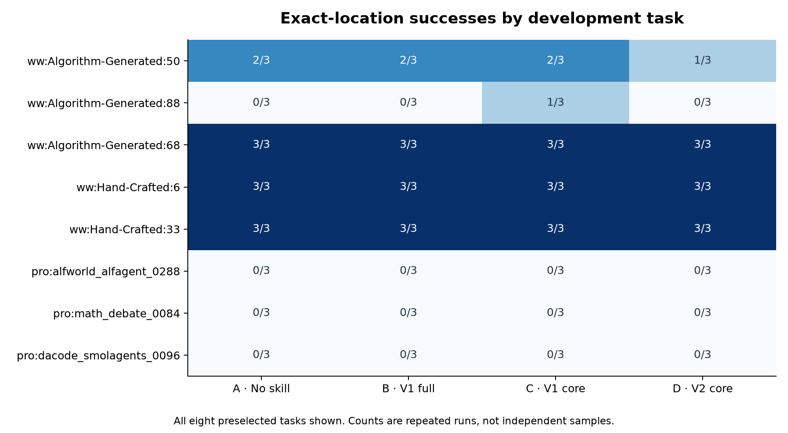

# 四组开发消融结果

计划 96 次，记录 96 次；状态：{"completed": 96}。这是已用于设计的八任务集合，不能作为保留集提升证据。

| 条件 | 定位命中 | 准确率 | 输入 token | 输出 token | 墙钟中位数 |
| --- | ---: | ---: | ---: | ---: | ---: |
| A · No skill | 11/24 | 45.8% | 326,014 | 6,943 | 34.2s |
| B · V1 full | 11/24 | 45.8% | 480,904 | 7,996 | 35.2s |
| C · V1 core | 12/24 | 50.0% | 367,076 | 7,057 | 34.3s |
| D · V2 core | 10/24 | 41.7% | 349,428 | 7,191 | 35.3s |

| 对比 | 差值（百分点） | 配对 95% 区间（百分点） |
| --- | ---: | --- |
| C_minus_B | +4.2 | [+0.0, +12.5] |
| D_minus_C | -8.3 | [-20.8, +0.0] |
| D_minus_A | -4.2 | [-12.5, +0.0] |
| B_minus_A | +0.0 | [+0.0, +0.0] |

先按任务平均三次，再按八个任务聚类重采样。区间只描述当前开发集合；没有多重比较调整，不作为显著性结论。输入 token 包含缓存部分；输出按 CLI 原样记录，不再加推理 token。墙钟含启动与网络、并发影响，费用未知。

[冻结清单](manifest.json) · [分析方案](ANALYSIS_PLAN.md) · [逐次结果](predictions.json) · [分数据集指标与资源](summary.json)。人工理由复盘另列，不是盲评或预先登记的效果指标。
