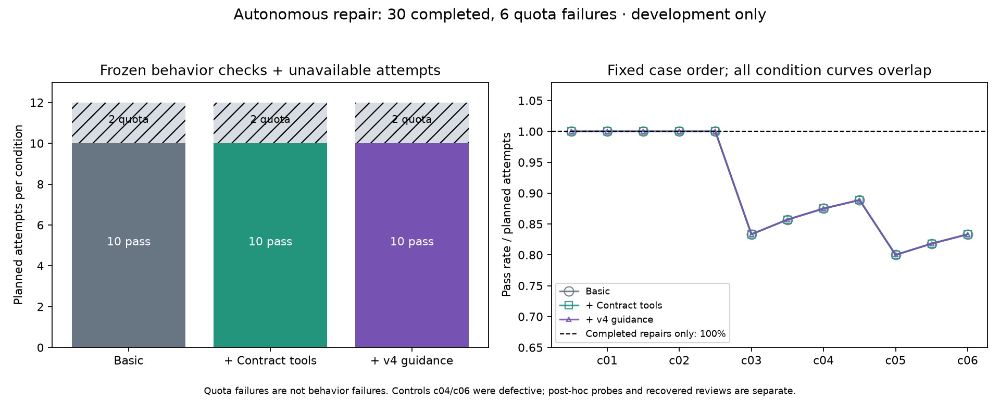

# 自主建模与跨运行机制修复：开发试验报告

**原冻结行为验收、独立结构评审、事后补充探针分别报告。不得拼成统一质量分数。**

本轮从原始代码和需求出发，直接修改实现、自行交付结构模型。三个运行机制各两个变体，三组各重复两次，共 36 次修复尝试。全部为开发材料，图家族此前已见过。

**额度故障：30 次修复有效完成，6 次中断；原 36 次盲评全部失败，没有语义判定。** 失败仍计入原计划分母。2026-10-04 另行注册评审恢复批次，对全部 31 份可解析模型重新发起独立评审；不补跑代码任务。CLI 版本不同，两个批次不能混写。5 次缺少模型，1 份模型来自未完成的 B/c03/2。

**重要更正：c04 和 c06 的预设正常标签不成立。** c04 漏掉提交失败后的撤销；c06 漏掉清理与取消的交错。原输入、调度、验收和分数不变。两个任务的修改不能被解释为误改正常实现；`summary.json` 中按旧标签计算的初始判断匹配数和正常不修改数也不能当作正确率或误报率。

## 原冻结结果

| 条件 | 有效完成 | 全部原行为检查通过 | 完成任务的模型格式有效 | 原盲评 |
| --- | ---: | ---: | ---: | --- |
| A_basic | 10/12 | 10/12 | 10/12 | 不可用：12 次额度失败 |
| B_tools | 10/12 | 10/12 | 10/12 | 不可用：12 次额度失败 |
| C_v4 | 10/12 | 10/12 | 10/12 | 不可用：12 次额度失败 |

A 为基本工具；B 加确定性契约工具；C 在 B 上增加 v4 指导与按需参考，包括运行包自带的通用检索示例。没有提供当前任务的参考模型。全部共同要求 model.json，所以不是自然触发测试。评审 covered 表示满足有限的机制判据及范围说明，不是数学证明或完整行为正确。无效执行保留在计划分母中。

累计曲线按 c01–c06、每例两个重复排序；这不是训练曲线。不能与此前外部归因题或配置修复分数拼成提升曲线。

原自动图和原统计仍保留，但其中原评审的 0/12 代表没有有效评审，不能解释为零语义覆盖率。30 次有效完成任务均通过原有限检查，并不意味着完整契约已满足。

## 独立结构评审恢复批次

请求模型仍为 gpt-6-astra/high，CLI 为 codex-cli 0.160.0；原 CLI 是 0.158.0-alpha.2.1。评审者只看原冻结输入包，不看组别和事后探针。文风可能透露指导风格，所以仍是部分盲评。

| 条件 | 有效评审 / 可评模型 | 完成修复产物：三项均 covered | 所有产物的判据标签 |
| --- | ---: | ---: | --- |
| A_basic | 10/10 | 10/10 | {"covered": 30} |
| B_tools | 11/11 | 10/10 | {"covered": 33} |
| C_v4 | 10/10 | 10/10 | {"covered": 30} |

B 多出的一份是中断任务的中间产物，其评审不能升级原任务状态。covered 表示满足预设的有限机制判据；维护者的事后反例复核另列，不能当作这些评审已经看到的证据。

## 逐任务原行为验收

| 任务 | 机制及原标签 | A_basic | B_tools | C_v4 |
| --- | --- | ---: | ---: | ---: |
| c01 | graph / incident | 2/2 | 2/2 | 2/2 |
| c02 | graph / normal | 2/2 | 2/2 | 2/2 |
| c03 | transaction / incident | 1/2 | 1/2 | 1/2 |
| c04 | transaction / normal（标签已证伪） | 2/2 | 2/2 | 2/2 |
| c05 | async_group / incident | 1/2 | 1/2 | 1/2 |
| c06 | async_group / normal（标签已证伪） | 2/2 | 2/2 | 2/2 |

配对差值先在每个机制内平均变体和重复，只有三个家族。下列重采样范围枚举 27 种抽取三个家族的有放回组合，仅是敏感性描述，不能作为可靠总体置信区间。

| 对比 | 三个家族的差值 | 均值 | 27 种重采样范围 |
| --- | --- | ---: | --- |
| B_tools minus A_basic | +0.0, +0.0, +0.0 pp | +0.0 pp | [+0.0, +0.0] pp |
| C_v4 minus B_tools | +0.0, +0.0, +0.0 pp | +0.0 pp | [+0.0, +0.0] pp |
| C_v4 minus A_basic | +0.0, +0.0, +0.0 pp | +0.0 pp | [+0.0, +0.0] pp |

## 事后边界探针

**本节由已观察到的代码和缺陷启发，没有预注册，不用于宣称 Skill 增益。** 统一检查所有事务和异步提交，原分数不被替换。异步探针含两个清理/取消交错；事务探针检查提交被读锁阻止后批次撤销与连接复用。

| 机制 | A_basic | B_tools | C_v4 |
| --- | ---: | ---: | ---: |
| async_group | 2/3（计划 2/4） | 3/3（计划 3/4） | 3/3（计划 3/4） |
| transaction | 1/3（计划 1/4） | 2/3（计划 2/4） | 2/3（计划 2/4） |

每格先列有效完成产物的结果，括号保留全部计划分母；每组每机制有一次额度失败。有效正常控制只剩图任务 c02；每组两个重复，不能估计通用误报率。修订的事务/异步正常参考通过原验收和新增探针，但尚未作为新输入重做模型对照。

| c02 正常控制 | 原行为验收通过 | 源文件不变 |
| --- | ---: | ---: |
| A_basic | 2/2 | 2/2 |
| B_tools | 2/2 | 2/2 |
| C_v4 | 2/2 | 2/2 |

## 实际资源记录

| 条件 | 已记录修复输入 token | 其中缓存输入 | 已记录修复输出 token | 全部尝试墙钟中位数 |
| --- | ---: | ---: | ---: | ---: |
| A_basic | 1,231,665 | 957,056 | 79,654 | 272.0s |
| B_tools | 1,296,781 | 1,005,184 | 77,669 | 297.6s |
| C_v4 | 1,629,543 | 1,300,224 | 73,068 | 264.3s |

| 条件 | 恢复评审输入 token | 恢复评审输出 token | 原修复工具执行命令匹配运行数 |
| --- | ---: | ---: | ---: |
| A_basic | 135,861 | 8,316 | 0/12 |
| B_tools | 148,257 | 8,955 | 7/12 |
| C_v4 | 135,433 | 8,080 | 10/12 |

资源数据直接使用 CLI 记录。6 次失败修复和全部原评审缺少用量，不能把缺失当成零成本；列出的修复总量是不完整的已记录总量。输入含缓存部分，不等于收费 token；费用未知。墙钟含额度失败、模型与工具等待，不是纯服务延迟。恢复评审各组产物数量不同，不直接比较总成本高低。工具统计为命令文本匹配的代理指标，不是工具效用证明。原批次缺失用量条目：`{"A_basic": {"repair_usage_missing": 2, "review_usage_missing": 12}, "B_tools": {"repair_usage_missing": 2, "review_usage_missing": 12}, "C_v4": {"repair_usage_missing": 2, "review_usage_missing": 12}}`。

## 复核入口

- [冻结方案](ANALYSIS_PLAN.md) 与 [清单](manifest.json)。
- [原汇总](summary.json) 与 [事后边界审计](boundary-audit.json)。
- [原额度故障证据](infrastructure-audit.json) 与 [评审恢复协议](review-recovery-2026-10-04/PROTOCOL.md)、[恢复汇总](review-recovery-2026-10-04/summary.json)。
- [维护者复核](CURATOR_REVIEW.md)：保留盲评原标签，并记录补充证据或分歧。
- [复现说明](../../../docs/code-repair-evaluation.md) 与 [完成边界分析](../../../docs/completion-boundaries.md)。

逐次产物位于 results/，每个目录包含提交代码、模型、测试、补丁、命令审计和评审记录。原始服务日志留在本地忽略目录；公开记录保留其哈希。所有实验失败、无效输出和修订说明必须保留，不按结果补跑。
