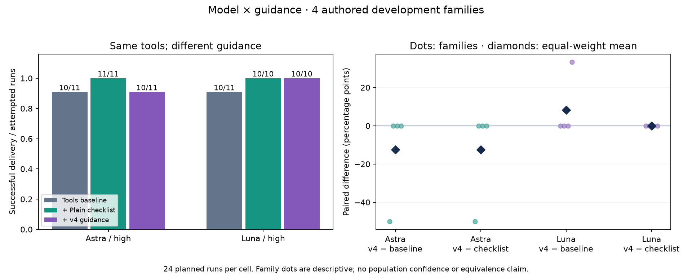
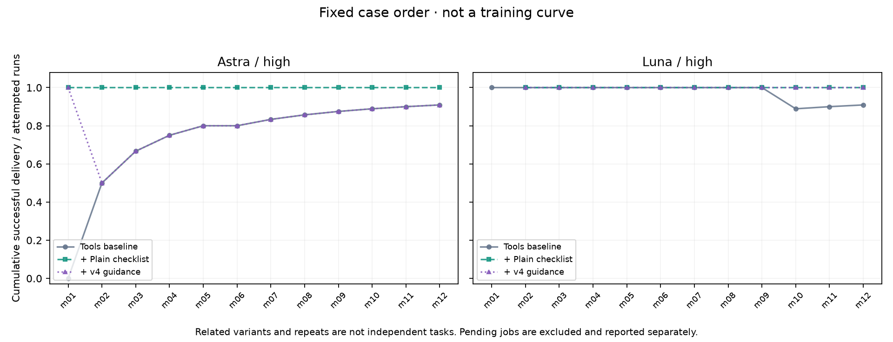

<!-- model-interaction-validity:start -->
> **事后核实的有效性限制：** m08 的“正常参考”遗漏非法 JSON 接受缺陷，m02 遗漏 Python 字符串的存储/往返边界并有 payload 域歧义，原隐藏验收均未覆盖。下文正常误报计数依冻结标签机械计算，不能解释为真实误报率；任何机器筛查门槛均不能据此授权版本升级。原始分数、输入和判据没有重写，修订反例另存为开发材料。[发现与复核](EXECUTION_REVIEW.md)。本轮维护决定为保留候选，不升级默认 Skill；具体模型差异须结合完整结果与这些限制解读。
>
> **执行修订披露：** 原执行器在 64 次尝试后把日志文件名中的 `401` 误判为鉴权失败；该次实际超时且未有效交付，旧记录与下文 infrastructure 计数仍保留，不能当作真实鉴权故障。后续仅允许按[单独恢复登记](RECOVERY_PLAN.md)继续原调度中 80 个从未开始的任务，最多仍为 144 次，没有重跑旧任务；当前实际完成数量以下表为准。
<!-- model-interaction-validity:end -->

# 模型与指导交互：开发筛查结果

计划 144 次，已尝试 64 次，未开始 80 次。两个工具连通性 canary 另列，不计入效果。

**版本决定：**计划未完整完成，或有基础设施/隔离问题；不作效果升级决定。

本轮为四个新编写的标准库任务家族，每个包含组合缺陷、正常实现、节点内部缺陷，两个模型、三个指导条件、每题两次。全部是开发材料；不是外部专业基准或生产泛化结果。

## 业务交付与成本记录

| 模型 | 条件 | 有效完成 | 首指标通过 / 已尝试（计划 24） | 最终源码行为通过 | 输入 token | 输出 token | 缺失用量 |
| --- | --- | ---: | ---: | ---: | ---: | ---: | ---: |
| Astra | 共同工具 | 10 | 10/11 | 11 | 1,260,995 | 49,893 | 0 |
| Astra | 加简短清单 | 11 | 11/11 | 11 | 1,241,330 | 48,878 | 0 |
| Astra | 加 v4 指导 | 10 | 10/11 | 11 | 1,214,061 | 41,317 | 1 |
| Luna | 共同工具 | 11 | 10/11 | 10 | 1,314,621 | 42,217 | 0 |
| Luna | 加简短清单 | 10 | 10/10 | 10 | 1,104,949 | 34,036 | 0 |
| Luna | 加 v4 指导 | 10 | 10/10 | 10 | 1,503,265 | 46,727 | 0 |

首指标要求有效交付且全部隐藏业务验收通过；中断产物即使通过也不算成功。输入包含缓存读取，缓存 token 不再叠加。Codex 登录运行没有可核验单次货币账单；这些数字不代表实际收费。两个模型的相同 high 设置不等于相同算力。

## 正常保护与任务种类

| 模型 | 条件 | 组合缺陷修复 | 节点内部缺陷修复 | 正常业务通过 | 正常误报 / 不确定 / 无结论 | 正常源码改动 |
| --- | --- | ---: | ---: | ---: | ---: | ---: |
| Astra | 共同工具 | 3/4 | 3/3 | 4/4 | 2 / 0 / 0 | 2 |
| Astra | 加简短清单 | 4/4 | 3/3 | 4/4 | 1 / 0 / 0 | 1 |
| Astra | 加 v4 指导 | 4/4 | 3/3 | 3/4 | 0 / 0 / 1 | 1 |
| Luna | 共同工具 | 3/4 | 3/3 | 4/4 | 2 / 0 / 0 | 2 |
| Luna | 加简短清单 | 3/3 | 3/3 | 4/4 | 2 / 0 / 0 | 2 |
| Luna | 加 v4 指导 | 3/3 | 3/3 | 4/4 | 2 / 0 / 0 | 2 |

源码改动不是误报；正常行为回归与口头诊断分开。全部验收通过仅覆盖冻结的输入与义务，不是对所有实现状态的证明。

## 预先声明的配对比较

六个模型/条件单元全部有记录的 case×repeat 配对块为 10/24。先在家族内平均，再对家族等权；下表使用这些完整块。

| 模型 | 比较 | 完整配对差值（百分点） | 全部已尝试的原始差值 | 为正的家族数 / 4 |
| --- | --- | ---: | ---: | ---: |
| Astra | v4 − 基线 | -12.5 | +0.0 | 0 |
| Astra | v4 − 简短清单 | -12.5 | -9.1 | 0 |
| Astra | 简短清单 − 基线 | +0.0 | +9.1 | 0 |
| Luna | v4 − 基线 | +8.3 | +9.1 | 1 |
| Luna | v4 − 简短清单 | +0.0 | +0.0 | 0 |
| Luna | 简短清单 − 基线 | +8.3 | +9.1 | 1 |

交互差值 `(Luna v4−基线)−(Astra v4−基线)` 为 **+20.8 个百分点**。正数也只描述这两个指定配置，不是模型越小越有收益的普遍规律。

全部已尝试的原始差值在运行不完整时可能受到任务构成不平衡影响。四家族的 256 种重采样敏感性分布保存在 summary.json，不能当可靠总体置信区间。没有显著性或多重比较结论；全满分时退化区间不证明效果相等。

曲线按预先编号的任务顺序、每题两个重复累积，不是训练曲线。不同家族与正常/故障变体相关，不能把调用数或验收断言数当独立样本数。

## 逐题结果

| 任务 | 家族 / 变体 | Astra 基线 | Astra 清单 | Astra v4 | Luna 基线 | Luna 清单 | Luna v4 |
| --- | --- | ---: | ---: | ---: | ---: | ---: | ---: |
| m01 | lease_queue / incident | 0/1 | 1/1 | 1/1 | 1/1 | 0/0 | 0/0 |
| m02 | lease_queue / normal | 1/1 | 1/1 | 0/1 | 1/1 | 1/1 | 1/1 |
| m03 | lease_queue / local | 1/1 | 1/1 | 1/1 | 1/1 | 1/1 | 1/1 |
| m04 | retrieval_cache / incident | 1/1 | 1/1 | 1/1 | 1/1 | 1/1 | 1/1 |
| m05 | retrieval_cache / normal | 1/1 | 1/1 | 1/1 | 1/1 | 1/1 | 1/1 |
| m06 | retrieval_cache / local | 0/0 | 0/0 | 0/0 | 0/0 | 0/0 | 0/0 |
| m07 | stream_events / incident | 1/1 | 1/1 | 1/1 | 1/1 | 1/1 | 1/1 |
| m08 | stream_events / normal | 1/1 | 1/1 | 1/1 | 1/1 | 1/1 | 1/1 |
| m09 | stream_events / local | 1/1 | 1/1 | 1/1 | 1/1 | 1/1 | 1/1 |
| m10 | tool_results / incident | 1/1 | 1/1 | 1/1 | 0/1 | 1/1 | 1/1 |
| m11 | tool_results / normal | 1/1 | 1/1 | 1/1 | 1/1 | 1/1 | 1/1 |
| m12 | tool_results / local | 1/1 | 1/1 | 1/1 | 1/1 | 1/1 | 1/1 |

## 解释范围

- 当前比较固定共同工具，识别附加指导包效应；所有组都可查看结构检查脚本，因此不能用本轮分离工具自身的价值。
- 共同提示不强制契约建模；C 附带通用检索示例，B 与 C 的长度/内容不匹配，不能将差异单独归因范畴论或某条原则。
- 指导明确加载，不评估自动触发；模型后端精确快照不可见。
- 任务和测试由代理编写并在运行前交叉复核，仍有合成任务偏差与验收遗漏的可能。正常实现不等于已证明完整正确。
- 新进程与工作区限制不能构成恶意执行者的完整读隔离证明；执行记录需要人工/维护者回读。

[冻结方案](ANALYSIS_PLAN.md) · [运行前复核](PRECHECK_REVIEW.md) · [冻结清单](manifest.json) · [机器可读汇总](summary.json)
